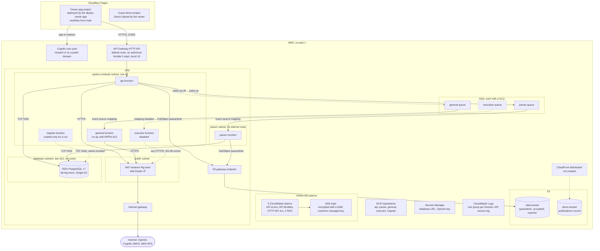
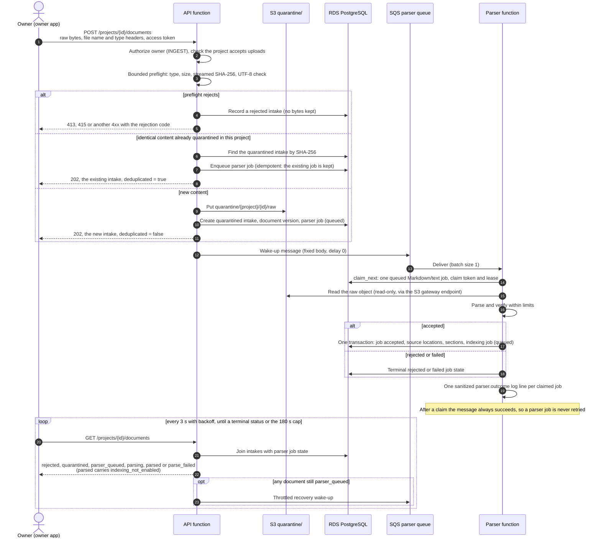
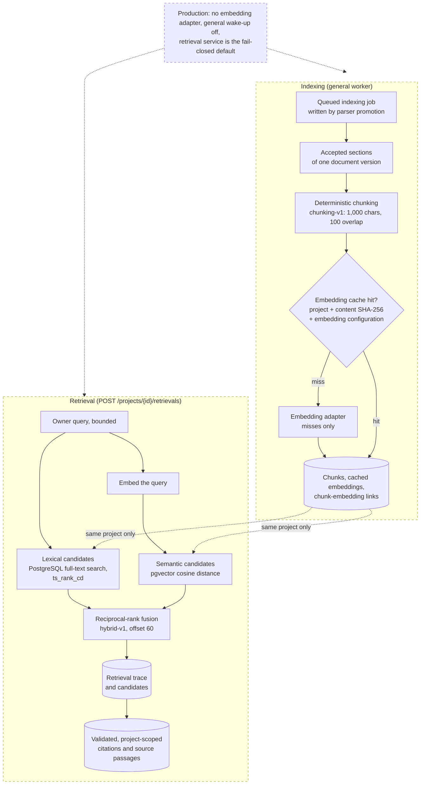
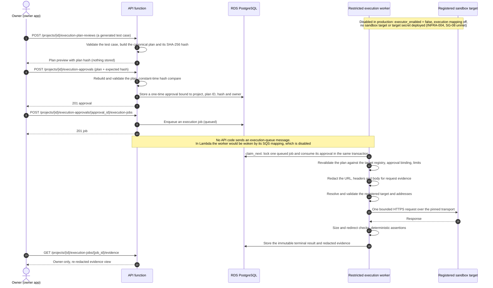

# Architecture Diagrams — AI Quality Engineering Copilot

**Draft (PORT-002), 2026-11-19.** These diagrams were derived on 2026-11-19
from committed documents and source code only. They were not checked against
the live AWS or Cloudflare accounts; "deployed" means what the committed
records say was applied or deployed. Owner review is pending, and PORT-002 is
not accepted.

How to read them:

- **Solid** boxes and arrows are live in production as recorded.
- **Dashed** boxes and arrows are implemented in code and tested but disabled
  in production, or not created; each one is labelled.
- No account IDs, domains, endpoints or resource IDs appear here (ADR-022
  privacy rule). The only address is the public guest demo already in the
  README.

The planned target design, with dated notes on what changed, stays in
[ARCHITECTURE.md](ARCHITECTURE.md). Where it and these diagrams differ, these
diagrams follow the later records cited under each one.

## 1. Context

```mermaid
flowchart LR
    Owner(["Owner"])
    Guest(["Guest or reviewer"])

    OwnerApp["Owner app<br/>static Next.js export<br/>on Cloudflare Pages"]
    GuestDemo["Guest demo<br/>static sanitized snapshot<br/>on Cloudflare Pages"]
    Cognito["Amazon Cognito<br/>Hosted UI, code + PKCE"]
    API["HTTP API + API function<br/>FastAPI on Lambda"]
    Parser["Restricted parser function"]
    DB[("RDS PostgreSQL")]
    S3Q[("S3 data bucket<br/>quarantine/")]
    OpenAI["OpenAI API"]

    General["General worker<br/>indexing and retrieval"]
    Executor["Restricted executor"]
    Target["Sandbox target"]
    Claude["Anthropic API"]

    Owner -->|"signs in"| Cognito
    Owner -->|"uses"| OwnerApp
    OwnerApp -->|"HTTPS + access token"| API
    Owner -->|"local publish script<br/>and Direct Upload"| GuestDemo
    Guest -->|"HTTPS, read-only"| GuestDemo
    API -->|"projects, uploads, status, runs"| DB
    API -->|"raw upload bytes"| S3Q
    API -->|"synthetic-text analysis"| OpenAI
    API -->|"queue wake-up"| Parser
    Parser -->|"read-only bytes"| S3Q
    Parser -->|"parsed sections"| DB

    API -.->|"wake-up off until INFRA-013"| General
    General -.-> DB
    API -.->|"approved job (disabled)"| Executor
    Executor -.->|"disabled, SG-08 unmet"| Target
    API -.->|"not in production"| Claude

    classDef off stroke-dasharray: 5 5
    class General,Executor,Target,Claude off
```

The guest demo makes no call to the API and opens no database connection.

**Source:** [ADR-018](adr/ADR-018-production-composition-lambda-runtime-and-secrets.md)
(production scope, model provider, handoff option A);
[ADR-019](adr/ADR-019-guest-demo-snapshot.md) (Decision 13);
[ADR-022](adr/ADR-022-owner-app-frontend-host.md);
[ADR-008](adr/ADR-008-cognito-owner-guest-authorization.md);
[ADR-013](adr/ADR-013-anthropic-claude-second-provider.md);
README status box and Architecture table;
`apps/api/src/ai_qa_copilot_api/main.py`, `general_wakeup.py`,
`lambda_workers.py`.

**Status:** live: owner sign-in, the owner app, the API, upload and parsing,
synthetic-text analysis, the guest demo. Implemented but disabled:
indexing and retrieval (INFRA-013), restricted execution (INFRA-004
deferred, SG-08 unmet), Anthropic Claude in production (ADR-018).

## 2. Deployment

Not drawn as arrows, to keep the picture readable:

- **Images:** every function pulls its image from its ECR repository.
- **Logs:** every function writes to its own log group.
- **Secrets:** the API and general functions read their secrets through the
  NAT instance at cold start. The parser's restricted database URL is a
  function environment variable (ADR-018 fallback).
- **Guest demo:** the owner's local script assembles the site folder offline.
  The owner then records each publication in the demo bucket and uploads the
  site folder to Cloudflare Pages, both by hand. Cloudflare does not read the
  bucket.

**Source:** [INFRASTRUCTURE.md](INFRASTRUCTURE.md) sections "INFRA-002 stage
1: network layout", "stage 2: NAT instance", "stage 3: data plane", "stage 4:
compute, API, guest demo and Cognito", "Production database, RDS for
PostgreSQL", "Migration runner", "HARD-003 alarms", "Guest demo publish and
deploy runbook" and "Owner-app deployment runbook";
[ADR-017](adr/ADR-017-network-egress-and-database-connectivity.md);
[ADR-018](adr/ADR-018-production-composition-lambda-runtime-and-secrets.md);
[ADR-019](adr/ADR-019-guest-demo-snapshot.md);
[ADR-020](adr/ADR-020-production-database-rds-postgresql.md);
[ADR-022](adr/ADR-022-owner-app-frontend-host.md);
`infra/modules/compute_api/main.tf` (the `executor_enabled` and
`demo_cdn_enabled` flags, `AI_QA_COPILOT_PARSER_WAKEUP_ENABLED`).

**Status:** live as recorded: everything solid. Disabled or not created: the
execution event source mapping and the executor (INFRA-004, SG-08), the
general wake-up (INFRA-013; the general mapping itself is enabled, and the
worker returns without work because production composes no embedding
adapter), the migrate function (created only for an owner-run migration, then
removed), and CloudFront (`demo_cdn_enabled = false` after AWS declined the
account's CloudFront verification).

## 3. Upload and parse sequence

On a deduplicated upload the owner app shows the same "Upload accepted.
Checking its status." message as for a new one. The owner reported that the
panel keeps showing it; that is an open item in
[PROJECT_STATUS.md](PROJECT_STATUS.md), not investigated here.

**Source:** `apps/api/src/ai_qa_copilot_api/main.py` (`upload_document`,
`list_documents`, `get_document`, `_raise_document_intake_rejected`);
`ingestion.py` (`DocumentIntakeService.receive`); `parser_queue.py`
(`SqlAlchemyParserJobQueue.enqueue`); `parser_wakeup.py`; `lambda_workers.py`
(`build_parser_composition`, `SqsWorkerHandler`); `parser_promotion_worker.py`;
`parser_evidence_promotion.py`; `document_status.py`;
`apps/web/src/app/upload-panel.tsx`; `apps/web/src/lib/document-polling.ts`;
[ADR-009](adr/ADR-009-parser-isolation.md);
[ADR-018](adr/ADR-018-production-composition-lambda-runtime-and-secrets.md)
(queue handlers, wake-up semantics); INFRASTRUCTURE.md "First end-to-end
uploads" and "Parser wake-up".

**Status:** live for Markdown and text. PDF is outside the production scope
(ADR-018); the production parser claims only Markdown and text jobs. The
queued indexing job stays queued in production (INFRA-013).

## 4. Retrieval (RAG) pipeline

**Implemented in code and tested; not enabled in production (INFRA-013).**

The retrieval route persists a trace and citations; it never returns a
generated answer.

**Source:** `apps/api/src/ai_qa_copilot_api/indexing.py` (`IndexingService`,
chunking and embedding defaults); `indexing_worker.py`; `lambda_workers.py`
(`build_general_composition`, disabled without an embedding adapter);
`hybrid_retrieval.py` (lexical and pgvector candidates,
`reciprocal-rank-fusion-v1`, offset 60); `retrieval_citation_linkage.py`;
`citations.py`; `main.py` (the `/retrievals` route, default
`UnavailableRetrievalCitationService`);
[ADR-003](adr/ADR-003-hybrid-retrieval.md);
[ADR-018](adr/ADR-018-production-composition-lambda-runtime-and-secrets.md).

**Status:** implemented but disabled in production (INFRA-013). Tests
exercise it locally; no production indexing or retrieval has run.

## 5. Approval and execution sequence

**Implemented in code and tested; executor disabled in production (INFRA-004
deferred, SG-08 unmet).**

**Source:** `apps/api/src/ai_qa_copilot_api/main.py` (execution-plan-review,
execution-approval, execution-job and evidence routes);
`execution_plans.py`; `execution_approvals.py` (`ExecutionApprovalService`);
`execution_jobs.py` (`SqlAlchemyExecutionJobQueue.claim_next`);
`execution_worker.py`; `restricted_execution.py`;
`restricted_http_transport.py`; `target_registry.py`; `execution_results.py`;
`execution_evidence.py`; `lambda_workers.py` (`build_executor_composition`);
[ADR-004](adr/ADR-004-safe-http-execution-topology.md);
[ADR-017](adr/ADR-017-network-egress-and-database-connectivity.md);
[ADR-018](adr/ADR-018-production-composition-lambda-runtime-and-secrets.md);
INFRASTRUCTURE.md "INFRA-002 stage 4" (the execution mapping).

**Status:** implemented but disabled in production. The executor has never
run in production. Its target network validation in the repository is
exercised with fake resolvers and transports and the in-process mock order
API in tests.
